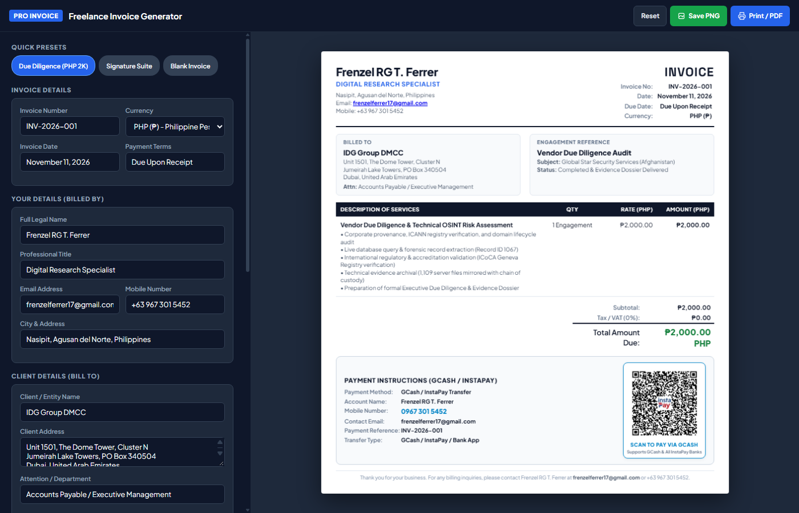
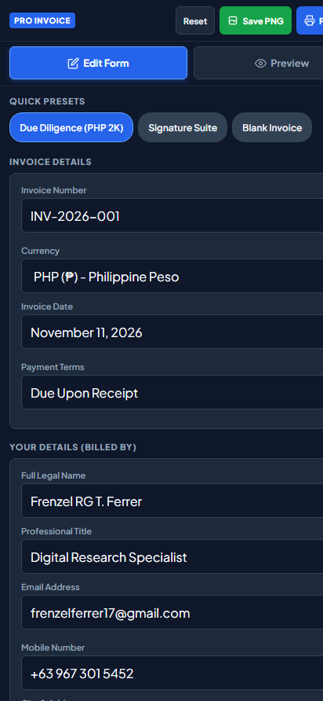

# Freelance Invoice Generator

A responsive, single-page freelance invoice generator web application featuring live real-time preview, QR code payment support, and 1-click **1-Page PDF** and **High-Resolution PNG** export.

Designed for freelancers, independent consultants, and service providers who need clean, professional, single-page invoices without awkward page-break overflow.

---

## Visual Preview & Screenshots

### Desktop Split-Pane Interface
The desktop interface features an independently scrolling left form sidebar paired with a pinned, auto-fitted invoice preview pane that stays perfectly in view without vertical scroll jump.



---

### Mobile Tabbed Interface
On mobile screens, the layout automatically transforms into a touch-friendly segmented tab interface (**Edit Form** and **Preview**), preventing screen crowding and avoiding mobile auto-zoom issues.



---

### Exported 1-Page Invoice Sample
Every invoice is strictly calibrated to guarantee a clean 1-page output—free of trailing blank pages or broken sections.


---

## Key Features

- **Guaranteed Single-Page Layout**: Print and raster styles ensure headers, line-item tables, payment details, and QR codes fit cleanly onto an exact single page.
- **1-Click High-Resolution PNG Export**: Embedded raster rendering engine (`html2canvas`) captures crisp, retina-ready PNG invoice images directly in the browser with zero external API calls.
- **1-Click Vector PDF Generation**: Pre-configured CSS `@media print` rules remove UI toolbars and backgrounds for crisp, standards-compliant vector PDF printing.
- **Dynamic Multi-Currency Support**: Switch between PHP (₱), USD ($), EUR (€), GBP (£), AUD ($), CAD ($), SGD ($), and AED (AED) with automatic symbol updating across subtotals and grand totals.
- **Dynamic Line Items**: Add, customize, and delete line items with instant automatic calculation of subtotals, tax/VAT rates, and balance due.
- **Payment & QR Code Integration**: Dedicated fields for Bank Wire / Electronic Transfer info and GCash / Digital Wallet QR code rendering.
- **Quick Presets**: Instant one-click templates to quickly prefill client data or reset to a clean blank slate.
- **100% Client-Side & Private**: Runs entirely in your web browser. No tracking, no analytics, no external servers, and zero data leaves your machine.

---

## How to Use

### Option 1: Run Locally (Offline)
1. Clone or download this repository:
   ```bash
   git clone https://github.com/zyf3rr3r/Invoice-Generator.git
   ```
2. Double-click `index.html` to open it in any web browser (Chrome, Edge, Safari, Firefox).
3. Fill in your details, select your currency, customize line items, and click **Print / Save 1-Page PDF** or **Save as PNG**.

---

### Option 2: Free Hosting on GitHub Pages
To use the generator anywhere on your phone or laptop as a live web application:
1. Navigate to your repository **Settings** on GitHub.
2. Select **Pages** from the left-hand navigation menu.
3. Under **Build and deployment** > **Source**, choose **Deploy from a branch**.
4. Select the `main` branch and folder `/(root)`, then click **Save**.
5. Your live app will be accessible at:
   ```
   https://zyf3rr3r.github.io/Invoice-Generator/
   ```

---

## Project Structure

```
Invoice-Generator/
├── index.html                  # Standalone web app (all CSS, HTML, and JS included)
├── README.md                   # Project documentation and screenshots
├── .gitignore                  # Git ignore rules for exports and temp files
└── screenshots/
    ├── desktop_preview.png     # Desktop split-pane screenshot
    ├── mobile_preview.png      # Mobile tabbed view screenshot
    └── sample_invoice_output.png # High-res sample invoice export
```

---

## License

This project is open-source and available under the [MIT License](LICENSE).
